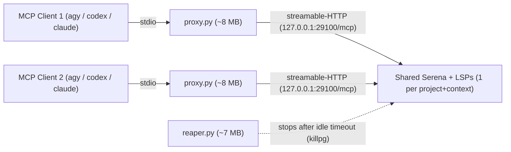

# serena-shared

Share **one** long-lived [Serena](https://github.com/oraios/serena) MCP server (and its language servers) per `(project, context)` across multiple stdio MCP clients—such as Antigravity (`agy`), Codex, or Claude Code.

## Why?

On large monorepos, a single Serena instance plus its LSP children (Pyright, `tsserver`, etc.) can easily consume **several gigabytes of RAM**. Running 5–6 agent sessions in the same repo with standard stdio MCP spawns 5–6 duplicate Serena + LSP stacks.

`serena-shared` runs one streamable-HTTP Serena server per `(project, context)` and attaches each stdio client via a lightweight (~8 MB) Python proxy, with an automatic idle reaper that shuts down unused servers and their LSP process groups.

## Architecture



- **Outside a git/Serena project** (or with `SERENA_SHARED=0`): automatically falls back to a private stdio Serena server so unrelated sessions don't switch each other's active project.
- **Pre-initialization safety:** handles pre-session probes (such as `server/discover`) locally with JSON-RPC `-32601` and drops pre-session notifications (such as `notifications/roots/list_changed`) so streamable-HTTP doesn't reject them with `HTTP 400`.
- **Clean session & process lifecycle:** sends `DELETE /mcp` on proxy exit, double-forks Serena to prevent zombies, rotates logs on restart, and terminates the entire Serena + LSP process group when idle.

## Requirements

- Linux / macOS with `bash`, `flock`, `realpath`, and `serena-agent` installed (e.g. via `uv tool install serena-agent`)
- Python environment from `serena-agent` (provides `mcp`, `httpx`, `anyio`)

## Installation

```bash
git clone https://github.com/ryanwclark1/serena-shared.git
cd serena-shared
./install.sh
```

This symlinks:
- `~/.local/bin/serena-shared` → `bin/serena-shared`
- `~/.local/lib/serena-shared/{proxy.py,reaper.py}` → `lib/{proxy.py,reaper.py}`

Use `./install.sh --copy` to copy instead of symlinking, or `./install.sh --uninstall` to remove. Make sure `~/.local/bin` is on your `PATH`.

## MCP Client Configuration

### Antigravity (`~/.gemini/config/mcp_config.json`)

```json
{
  "mcpServers": {
    "serena": {
      "command": "serena-shared",
      "args": ["--context", "antigravity"]
    }
  }
}
```

### Codex (`~/.codex/config.toml`)

```toml
[mcp_servers.serena]
command = "serena-shared"
args = ["--context", "codex"]
```

## Environment Variables

| Variable | Default | Description |
|---|---|---|
| `SERENA_SHARED` | `1` | Set to `0` to bypass sharing and run a private stdio Serena process |
| `SERENA_PROJECT` | *(auto-detected)* | Explicit project root (otherwise walks up from `cwd` to `.serena/project.yml` or `.git`) |
| `SERENA_BIN` | `~/.local/share/uv/tools/serena-agent/bin/serena` or `PATH` | Path to the `serena` executable |
| `SERENA_PYTHON` | `$(dirname $SERENA_BIN)/python` or `python3` | Python interpreter with `mcp`, `httpx`, and `anyio` |
| `SERENA_SHARED_LIB` | `<repo>/lib` or `~/.local/lib/serena-shared` | Directory containing `proxy.py` and `reaper.py` |
| `SERENA_SHARED_DIR` | `~/.serena/shared` | State, lock, and log directory |
| `SERENA_SHARED_IDLE_SECONDS` | `1800` | Idle timeout (seconds) before `reaper.py` stops a shared server |
| `SERENA_SHARED_REAPER_POLL` | `60` | Reaper poll interval (seconds) |
| `SERENA_SHARED_PORT_FIRST` / `PORT_LAST` | `29100` / `29199` | Localhost port range for shared servers |

## Running Tests

```bash
~/.local/share/uv/tools/serena-agent/bin/python -m unittest discover -s tests -v
```

## License

MIT
