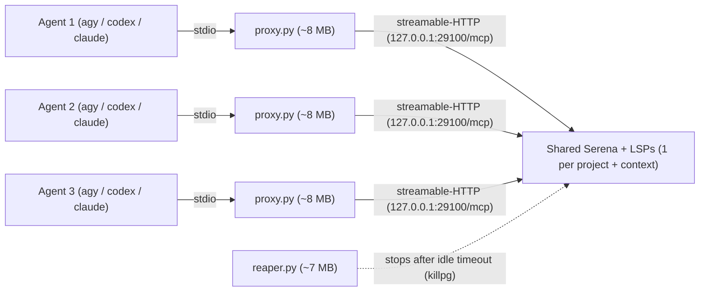

<p align="center">
  <picture>
    <source media="(prefers-color-scheme: dark)" srcset="assets/logo-dark.svg">
    <source media="(prefers-color-scheme: light)" srcset="assets/logo-light.svg">
    
  </picture>
</p>

<p align="center">
  <strong>Share one Serena MCP server and its language servers across multiple agent sessions.</strong>
</p>

<p align="center">
  <a href="LICENSE"></a>
  
  
  
</p>

<p align="center">
  <a href="#why">Why</a> &middot;
  <a href="#how-it-works">How It Works</a> &middot;
  <a href="#installation">Installation</a> &middot;
  <a href="#client-configuration">Client Config</a> &middot;
  <a href="#configuration">Env Vars</a> &middot;
  <a href="#troubleshooting">Troubleshooting</a>
</p>

---

## Why

When running [Serena](https://github.com/oraios/serena) over standard stdio MCP, every coding agent session (Antigravity, Codex, Claude Code, etc.) spawns its own Serena process plus its own language servers (Pyright, TypeScript/tsserver, rust-analyzer, gopls, etc.). On large monorepos, a single Serena + LSP stack can easily take **several gigabytes of RAM** and **20–30 seconds** to cold-start.

`serena-shared` transparently multiplexes all stdio MCP clients working in the same `(project, context)` onto **one** shared streamable-HTTP Serena server:

| Setup (5 concurrent agent sessions in one monorepo) | Serena + LSP processes | Approximate RAM | Startup for sessions 2–5 |
|---|---|---|---|
| Standard stdio `serena` | 5× Serena + 5× LSP stacks | ~25–30 GB | ~20–30s each |
| **`serena-shared`** | **1× Serena + 1× LSP stack + 5× `proxy.py` (~8 MB)** | **~5.8 GB** | **Instant (<100ms)** |

---

## How It Works



### Key Features

- **Per-`(project, context)` isolation:** Keys shared servers by `sha256(context, project_root)` so different repos and different client contexts (`antigravity`, `codex`, etc.) never collide.
- **Safe private-stdio fallback:** Automatically falls back to a private stdio Serena process when launched outside a `.git` / `.serena/project.yml` boundary, when `$HOME` would be indexed, or when `SERENA_SHARED=0`.
- **Pre-initialization protocol compatibility:** Clients like Antigravity send pre-session probes (`server/discover`) and early notifications (`notifications/roots/list_changed`) before `initialize` completes. `proxy.py` replies locally with JSON-RPC `-32601` and drops pre-session notifications instead of letting streamable-HTTP fail with `HTTP 400`.
- **Clean lifecycle & zero leaks:**
  - Sends `DELETE /mcp` on proxy exit so server-side MCP sessions don't linger.
  - Double-forks Serena into its own session (`setsid`) so it never becomes a zombie under `proxy.py`.
  - Background `reaper.py` terminates idle servers and their entire LSP process group (`killpg`) after 30 minutes of inactivity.
  - Rotates per-server logs (`<key>.log` → `<key>.log.prev`) on restart.

---

## Requirements

- Linux or macOS with `bash`, `flock`, and `realpath`
- `serena-agent` installed (e.g. `uv tool install serena-agent`) — `serena-shared` reuses `serena-agent`'s own Python environment (`mcp`, `httpx`, `anyio`), requiring **zero additional Python packages**

---

## Installation

```bash
git clone https://github.com/ryanwclark1/serena-shared.git
cd serena-shared
./install.sh
```

By default, `./install.sh` creates symlinks under `~/.local`:
- `~/.local/bin/serena-shared` → `bin/serena-shared`
- `~/.local/lib/serena-shared/{proxy.py,reaper.py}` → `lib/{proxy.py,reaper.py}`

Make sure `~/.local/bin` is on your `PATH`.

### Installer Options

```bash
./install.sh --copy        # Copy files instead of symlinking
./install.sh --uninstall   # Remove installed files/symlinks
PREFIX=/usr/local ./install.sh --copy
```

---

## Client Configuration

Replace your MCP server's `serena start-mcp-server` command with `serena-shared`:

### Antigravity (`~/.gemini/config/mcp_config.json`)

```json
{
  "mcpServers": {
    "serena": {
      "command": "serena-shared",
      "args": ["--context", "antigravity"]
    }
  }
}
```

### Codex CLI (`~/.codex/config.toml`)

```toml
[mcp_servers.serena]
command = "serena-shared"
args = ["--context", "codex"]
```

### Claude Code (`.mcp.json` or `~/.claude.json`)

```json
{
  "mcpServers": {
    "serena": {
      "command": "serena-shared",
      "args": ["--context", "claude-code"]
    }
  }
}
```

---

## Configuration

All behavior can be customized via environment variables:

| Variable | Default | Description |
|---|---|---|
| `SERENA_SHARED` | `1` | Set to `0` to bypass sharing and run a private stdio Serena process |
| `SERENA_PROJECT` | *(auto-detected)* | Explicit project root (otherwise walks up from `cwd` to `.serena/project.yml` or `.git`) |
| `SERENA_BIN` | `~/.local/share/uv/tools/serena-agent/bin/serena` or `PATH` | Path to the `serena` executable |
| `SERENA_PYTHON` | `$(dirname $SERENA_BIN)/python` or `python3` | Python interpreter with `mcp`, `httpx`, and `anyio` |
| `SERENA_SHARED_LIB` | `<repo>/lib` or `~/.local/lib/serena-shared` | Directory containing `proxy.py` and `reaper.py` |
| `SERENA_SHARED_DIR` | `~/.serena/shared` | State, lock, and log directory |
| `SERENA_SHARED_IDLE_SECONDS` | `1800` | Idle timeout in seconds before `reaper.py` stops a shared server |
| `SERENA_SHARED_REAPER_POLL` | `60` | Reaper poll interval in seconds |
| `SERENA_SHARED_PORT_FIRST` | `29100` | Start of localhost port range for shared servers |
| `SERENA_SHARED_PORT_LAST` | `29199` | End of localhost port range for shared servers |
| `SERENA_SHARED_READY_TIMEOUT` | `240` | Seconds to wait for a newly spawned Serena server to listen |

---

## Troubleshooting

State and logs live in `~/.serena/shared/`:

```bash
ls ~/.serena/shared/servers/        # Active shared server records (port, pid, context, project)
tail -f ~/.serena/shared/logs/*.log # Per-server Serena + HTTP logs
tail -f ~/.serena/shared/reaper.log # Idle reaper activity
```

- **Force a private instance for one session:** run with `SERENA_SHARED=0`.
- **Restart a shared server:** kill the `pid` listed in `~/.serena/shared/servers/<key>`; the next client will transparently start a fresh one.

---

## Development & Testing

```bash
# Syntax checks
bash -n bin/serena-shared install.sh
~/.local/share/uv/tools/serena-agent/bin/python -m py_compile lib/proxy.py lib/reaper.py

# Unit tests
~/.local/share/uv/tools/serena-agent/bin/python -m unittest discover -s tests -v
```

---

## License

[MIT](LICENSE)
